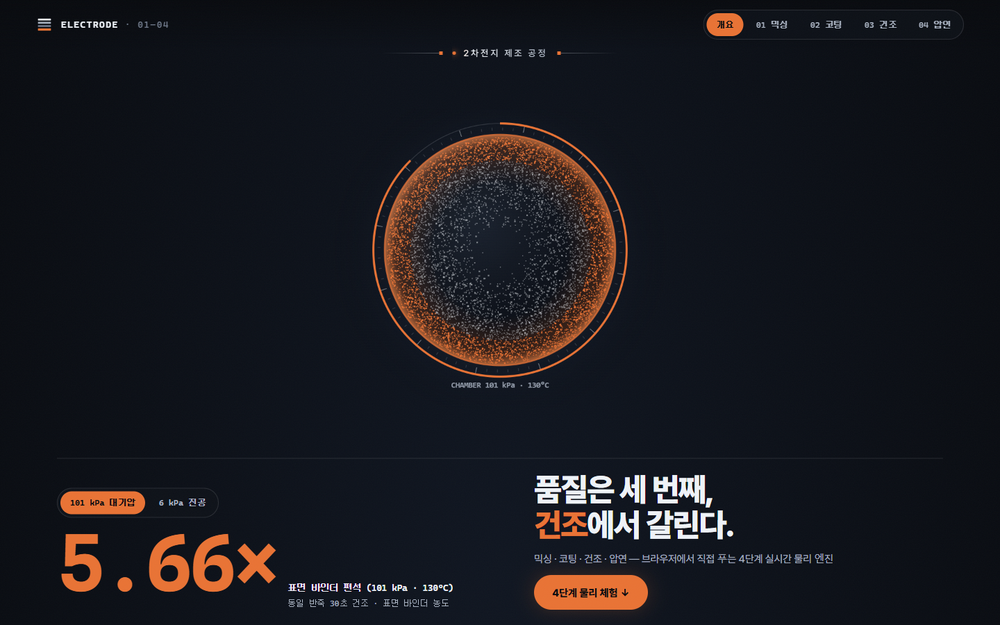
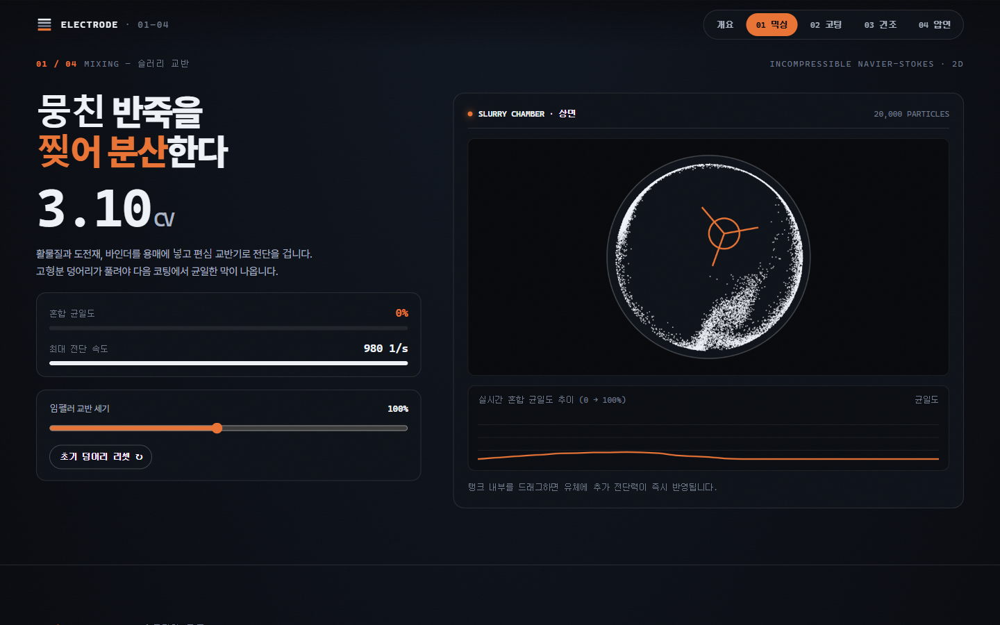
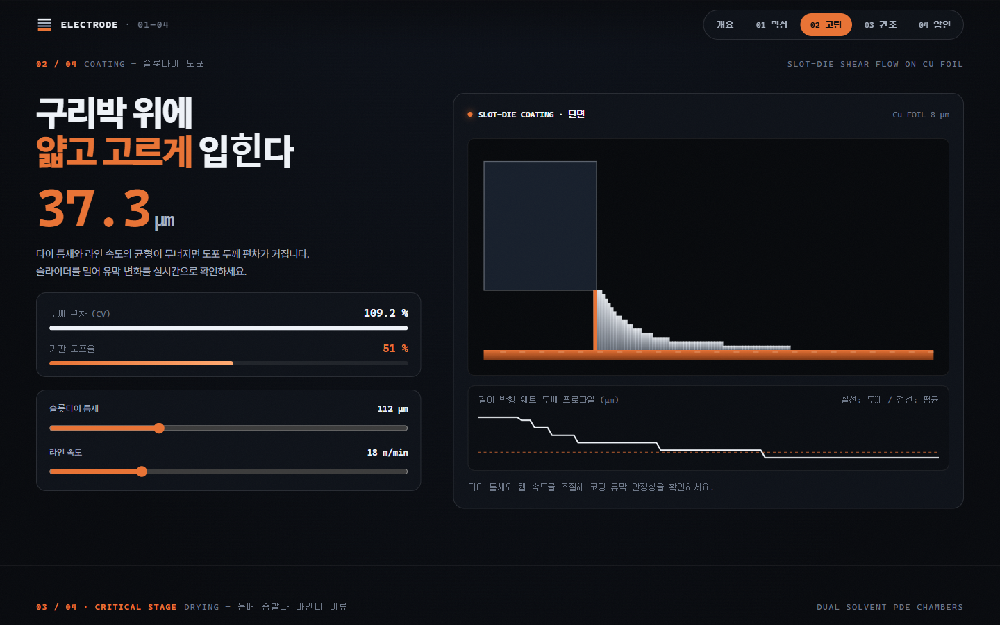
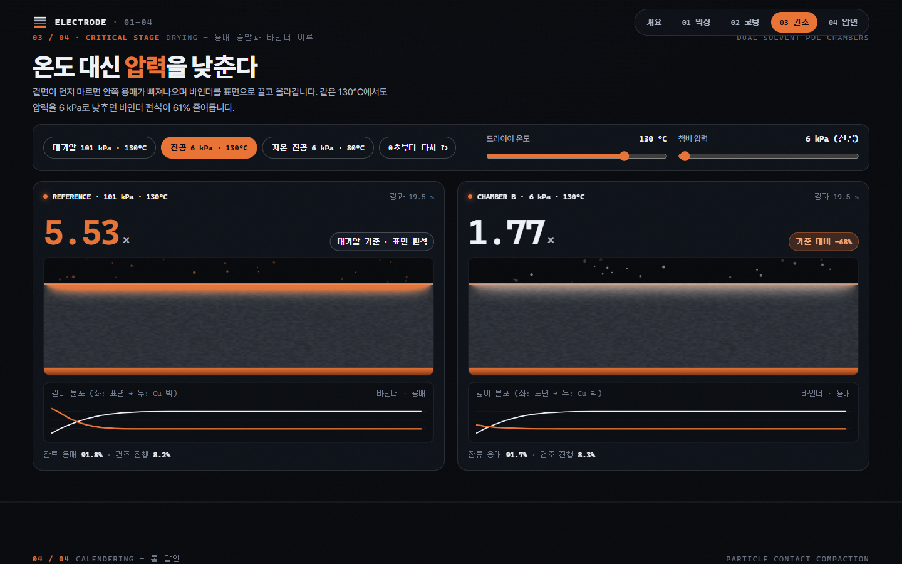
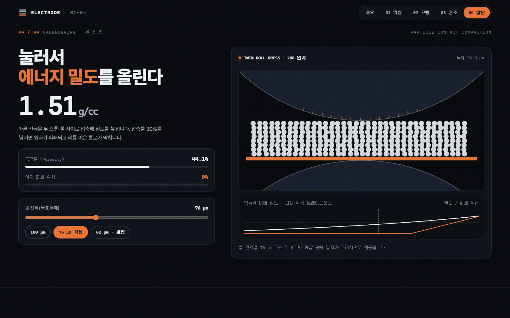

# 전극은 반죽에서 시작한다 — 2차전지 전극 공정 4단계

제1회 해커톤: 랜딩톤 출품작. 2차전지 전극을 만드는 네 단계(**믹싱 · 코팅 · 건조 · 압연**)를
소개하는 **한 장짜리 랜딩 페이지**이며, 각 단계의 그림은 **직접 작성한 물리 계산**이 실시간으로
그립니다. 외부 라이브러리를 쓰지 않았습니다.

- 공개 주소: https://electrode-process.baekjoohoon.workers.dev (Cloudflare Workers, 배포 디렉터리 `public/`)
- 로컬 미리보기: `node tools/serve.mjs "C:/AI_Agent/제1회 해커톤 랜딩톤" 8899` → `http://127.0.0.1:8899/public/index.html`
- 제출 마감: 2026년 12월 4일 24:00 (KST)

## 이야기

활물질 가루에 도전재·바인더를 섞고 용매를 부으면 검은 반죽이 됩니다. 그것을 박 위에 얇게 바르고,
말리고, 눌러서 전극을 만듭니다. 네 단계 모두 같은 문제를 풉니다 — **고르게**. 그중에서도
**건조**는 되돌릴 수 없는 단계입니다. 겉면이 먼저 마르면 남은 용매가 바인더를 표면으로 끌고
올라가, 겉은 단단하고 속은 약한 전극이 됩니다. 그래서 온도를 올리는 대신 압력을 낮춥니다.

## 네 장면 (전부 실제 계산)

| 단계 | 계산 | 페이지에서 만질 수 있는 것 |
|---|---|---|
| **01 믹싱** | 84×84 격자 비압축성 유체(자코비 압력 반복) + 고형분 입자 20,000개(작은 화면 12,000) 이류, 편심 3엽 교반기 | **임펠러 교반 세기**(`#m-rpm` 30~180) · 탱크 안 **마우스 드래그** |
| **02 코팅** | 160×44 슬롯다이 전단 유동, 유막 두께 프로파일 | **다이 틈새**(8~28) · **라인 속도**(6~54) |
| **03 건조** | 140×84 용매 확산 + 표면 증발(온도·압력 의존) + 바인더 이류·확산, **세 챔버 동시 비교**(대기압 101 kPa·130°C / 진공 6 kPa·130°C / 저온진공 6 kPa·80°C) | **드라이어 온도**(60~150) · **챔버 압력**(5~101) · 챔버 전환 버튼 |
| **04 압연** | 입자 288개 접촉 압축, 밀도·공극률·파쇄 위험 산출 | **롤 간격**(58~105 µm) — 70 µm 아래에서 과압 응력 입자가 구리색으로 점등 |

무대 오른쪽의 계측 패널은 프레임·모서리 틱·번호/제목·스케일 바·축 있는 보조 차트를 갖춘
계측기(instrument) 형식이고, 화면의 수치는 모두 그 계산에서 바로 읽어 옵니다.

## 검증된 수치 (결정적 시뮬레이션, `__bat.sim(초)`)

| 단계 | 측정 |
|---|---|
| 믹싱 | 불균일 지수 1.80(초기) → 교반으로 하락, 최대 전단 980 1/s |
| 코팅 | 웨트 두께 152.9 µm대 · 두께 편차(CV) 표시, 다이 틈새 112 µm |
| 건조 | **표면 바인더 5.66배(101 kPa·130°C) → 2.19배(6 kPa·130°C) = 61 % 감소**. 진공 전환 시 5.04→4.10→3.24→2.67→2.33으로 수렴하는 것을 직접 측정 |
| 압연 | 76 µ대에서 밀도 상승, 공극률·파쇄 위험 트레이드오프 표시 |

## 만든 방식

- **외부 라이브러리 0**: 렌더는 캔버스 2D, 화면 구성은 CSS. 물리·수치는 전부 이 저장소의 코드.
- **어두운 계기판 톤(참고 페이지와 다른 방향)**: 쿨 블루블랙(`#07090D`·`#0F1520`) 한 계열 + 구리 한 색(`#E87234`). 히어로는 프레임 없이 화면을 가득 채우는 교반 탱크 하나 —
  입자층을 블러해 뒤로 번지는 발광을 깔고, 안쪽 음영과 좌상단 하이라이트 림으로 빛과 깊이를 줍니다.
  제목은 최대 8.5rem까지 키우고 세리프 이탤릭 한 단어(시작)로 액센트를 두며, 탱크와 겹쳐 한 덩어리로 읽히게 했습니다.
  하단에는 계기판 형식의 스탯 세 개(모노·tabular 숫자)만 남기고, 고정 HUD는 히어로에서 감춥니다.
  나머지 장면의 비주얼도 화면 오른쪽을 크게 차지하고 보조 차트는 그 위에 작게 겹칩니다.
- **한 장 규칙 준수**: 다른 주소로 넘어가는 링크 0개. 스크롤 한 페이지에서 네 단계가 모두 이어집니다.
- **서체**: Pretendard 사용 글자만 남겨 자체 호스팅(`public/fonts/pretendard-subset.woff2`, 90KB),
  OFL 1.1 전문 포함(`LICENSE-Pretendard.txt`). 외부 이미지·음원·영상 없음.
- **반응형**: 900px 이하에서는 보조 차트를 생략하고, 히어로의 탱크를 하단 밴드로 내리며 본문 위에 어둠막을 깔아 읽힘을 지킵니다.
- **화면 최대 요소 = 실시간 측정값**: 참고 페이지의 "거대한 슬로건" 문법을 옮기지 않고, 히어로에서 가장 큰 요소를
  표면 바인더 비율(5.66× ↔ 2.19×)로 두었습니다. 압력 버튼을 누르면 그 숫자가 실제 계산과 함께 움직입니다.
- **자체 점검 훅**: `__bat.externalLinks()`(한 장 규칙), `__bat.overflow()`(가로 넘침), `__bat.errors`(렌더 루프 예외)를
  페이지가 스스로 검사합니다. 별도로 텍스트 요소 124개 전수 겹침 검사 → 0건, 해상도 2종에서 넘침 0을 확인했습니다.

## 파일 구조

```
public/
  index.html                      # 페이지 전부 (HTML + CSS + 물리 + 계측 렌더)
  fonts/pretendard-subset.woff2   # 사용 글자만 남긴 서브셋 (90KB)
tools/
  serve.mjs                       # 로컬 정적 서버 (no-store)
  subset-font.sh                  # 폰트 서브셋 재생성
wrangler.jsonc                    # Cloudflare Workers 배포 설정 (electrode-process)
docs/                             # 제출 문서 · 스크린샷 · 데모 영상
LICENSE-Pretendard.txt            # SIL Open Font License 1.1 전문
```

## 데모 영상 · 스크린샷

- 데모 영상(53초, 소리 없음, 1440×900, 7.9MB, 캡처 제약으로 6배속): [`docs/electrode-demo.mp4`](docs/electrode-demo.mp4)
- 스크린샷 5장(2160×1350): [`docs/screenshots/`](docs/screenshots/)

| 01 히어로 | 02 믹싱 | 03 코팅 |
|---|---|---|
|  |  |  |

| 04 건조 | 05 압연 |
|---|---|
|  |  |

영상 시나리오: 히어로에서 반죽을 휘젓고(마우스 드래그) → 코팅 틈새 28→10 → 건조 압력을 101→5 kPa → 압연 간격 118→62 µm → 마무리. 슬라이더 조작이 실제 계산값을 바꾸는 장면을 담았습니다.

## 개발용 훅

브라우저 콘솔에서 시뮬레이션을 직접 검사할 수 있습니다.

```js
__bat.probe()             // 시뮬레이션 시계(t), 넘침, 섹션 가시성, 건조 수치 등 원시값
__bat.layout()            // 뷰포트·dpr
__bat.overflow()          // 가로 넘침 여부
__bat.externalLinks()     // 다른 주소로 나가는 링크 수 (한 장 규칙 자체 점검)
__bat.freeze(true)        // 자동 스텝 정지 (캡처용)
__bat.bench(20)           // 스텝·렌더 시간 측정
__bat.errors              // 렌더 루프에서 잡힌 예외 수
```

## 외부 자료와 라이선스

| 자료 | 출처 | 라이선스 |
|---|---|---|
| 서체 Pretendard | [orioncactus/pretendard](https://github.com/orioncactus/pretendard) | SIL Open Font License 1.1 (`LICENSE-Pretendard.txt`) |
| 코드·그래픽 | 전부 이 저장소에서 직접 작성 | © 2026, 출품자 |

외부 라이브러리·이미지·음원·영상은 사용하지 않았습니다. 페이지의 모든 그래픽은 캔버스 2D로
실시간 생성합니다.
