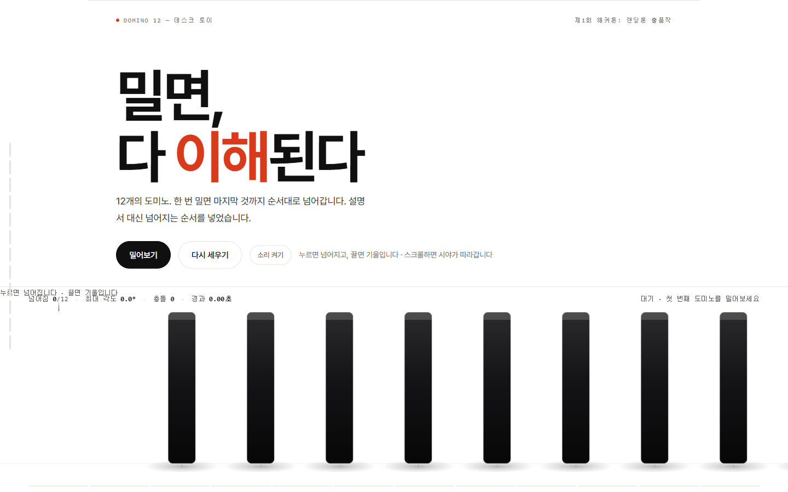
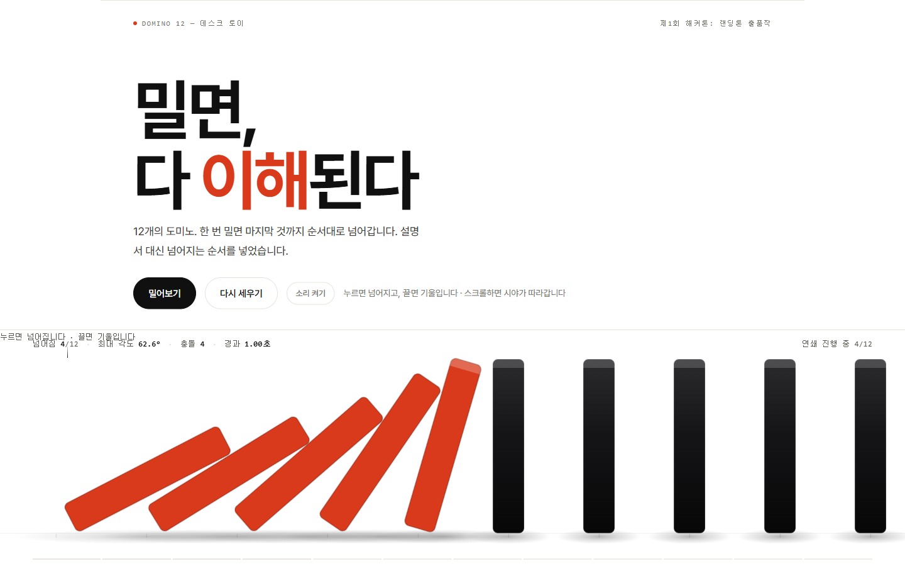
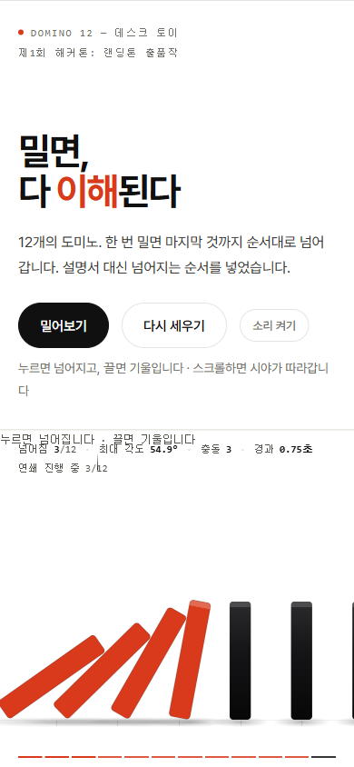

# DOMINO 12 — 밀면, 다 이해된다

제1회 해커톤: 랜딩톤 출품작. 도미노 12개 세트를 소개하는 **한 장짜리 랜딩 페이지**이며,
페이지 하단 무대에서 **직접 작성한 2D 강체 물리 엔진**이 실시간으로 도미노를 시뮬레이션합니다.

- 공개 주소: https://domino12.baekjoohoon.workers.dev (Cloudflare Workers, 배포 디렉터리 `public/`)
- 저장소: https://github.com/baekjoohoon/domino12
- 제출 마감: 2026년 12월 4일 (KST)

## 무엇을 보여 주는가

| 요소 | 내용 |
|---|---|
| 무대 | 12개의 도미노가 바닥 위에 서 있고, 스크롤·연쇄 진행에 따라 카메라가 따라갑니다 |
| 조작 | **누르면 밀립니다**(누른 지점이 높을수록 세게) · **끌면 기울입니다** · `밀어보기`/`다시 세우기` 버튼 · 키보드 `→` 밀기, `R` 다시 세우기 |
| 손끝 안내 | 첫 상호작용 전까지 첫 도미노 위에 "누르면 넘어집니다 · 끌면 기울입니다" 표시 |
| 무대 높이 | 화면 크기·비율에 따라 히어로에서는 화면의 42%(모바일 44%), 스크롤하면 29%(31%)까지 줄어 본문을 가리지 않습니다 |
| 연출 | 스크롤이 도미노를 밀고, 넘어진 도미노에 맞춰 해당 섹션이 열립니다 |
| 페이지 레일 | 1240px 이상에서 좌측 레일에 미니 도미노 12개가 세로로 매달려 있고, 읽는 위치가 임계점을 넘을 때마다 각도 적분(ω' = k·sinθ − c·ω)으로 하나씩 넘어집니다. 되돌리면 다시 섭니다 |
| 계측 | 넘어짐 개수 · 최대 각도 · 충돌 횟수 · 경과 시간을 실제 시뮬레이션 값으로 표시 |
| 소리 | 도미노가 부딪힐 때 합성한 클릭음(외부 음원 없음). 기본 꺼짐, 버튼으로 켭니다 |

## 물리 엔진

외부 물리 라이브러리를 쓰지 않고 직접 작성했습니다.

- **강체**: 위치·각도·선속도·각속도를 가진 회전 사각형 12개 + 정적 바닥 1개
- **충돌 검출**: SAT(분리축 정리)로 OBB 4축 검사, 꼭짓점-상자 검사로 접촉점 생성
- **접촉 마진**: 0.6 world px — 살짝 닿기만 해도 접촉을 유지해 정지 상태가 떨리지 않습니다
- **솔버**: 지난 스텝의 법선 임펄스를 재사용하는 **웜 스타트** + 누적 임펄스 방식의 순차 임펄스,
  쿨롱 마찰(μ=0.7), 반복 순서를 매 스텝 뒤집어 특정 접촉에 편향되지 않게 처리
- **위치 보정**: Baumgarte 방식(slop 0.4, 계수 0.7)
- **스텝**: 240Hz 고정 스텝, 프레임당 4 서브스텝
- **안정화**: 저속 정지(sleep) 판정, 이탈 가드(무대를 벗어나면 제자리 복구)

실측: 12개 전부 넘어지는 데 약 2.1~2.3초, 한 칸이 다음 칸을 넘기는 데 약 0.2초.
도미노는 두께 18mm·높이 100mm로 실제 도미노와 같은 1:5.5 비율입니다.

## 최신 웹 기법

- **CSS scroll-driven animations** (`animation-timeline: view()`) — 스크롤 진행에 묶인 등장 연출.
  미지원 브라우저와 `prefers-reduced-motion` 에서는 IntersectionObserver 경로로 자동 대체합니다.
- **`::details-content` + `interpolate-size: allow-keywords`** — `height: auto` 아코디언 전환
- **`text-box: trim-both`** — 제목의 광학 정렬
- **Web Audio API** — 도미노 클릭음을 코드로 합성(음원 파일 없음)
- **Pointer Events + `touch-action: none`** — 마우스·터치·펜 동일 동작
- 스크롤 가로채기(smooth scroll 라이브러리)는 쓰지 않았습니다. 무대 카메라의 관성만으로
  "무게감"을 만들고, 네이티브 스크롤의 접근성·성능 특성은 그대로 둡니다.

## 파일 구조

```
public/
  index.html                    # 페이지 전부 (HTML + CSS + 물리 엔진)
  fonts/pretendard-subset.woff2 # 사용 글자만 남긴 Pretendard 서브셋 (90KB)
tools/
  subset-font.sh                # 서브셋 재생성 스크립트
  PretendardVariable.woff2      # 원본(저장소에는 커밋하지 않음)
LICENSE-Pretendard.txt          # SIL Open Font License 1.1 전문
```

## 데모 영상 · 스크린샷

- 데모 영상(13초, 소리 없음): [`docs/domino12-demo.mp4`](docs/domino12-demo.mp4)
- 스크린샷: [`docs/screenshots/`](docs/screenshots/) — 커버(세워진 상태), 연쇄 중(붉은 파동), 본문, 물리 엔진 구간, 모바일

| 커버 | 연쇄 중 | 모바일 |
|---|---|---|
|  |  |  |

## 개발 중인 후속 출품 (주제 변경)

주제를 2차전지 전극 공정으로 바꾸는 작업을 `dev/`에서 진행 중입니다. 미리보기:
https://electrode-process.baekjoohoon.workers.dev (Cloudflare Worker `electrode-process`, 배포 디렉터리 `dev/`)

네 단계(믹싱·코팅·건조·압연)마다 물리를 직접 구현했습니다.

- **믹싱**: 격자 비압축성 유체(Stam, 자코비 압력 반복) + 고형분 입자 26,000개 이류, 편심 교반기로 시간 주기 유동
- **코팅**: 박이 끌고 가는 전단 유동, 다이 틈에서 공급·출구에서 배출, 유막 두께 프로파일을 벡터 단면으로 렌더
- **건조**: 용매 확산 + 표면 증발(온도·압력 의존) + 바인더 이류·확산, 표면 바인더 농도 평형
- **압연**: 입자층 대상 두께로의 압축, 밀도·공극률·파쇄 위험 산출

검증된 수치(결정적 시뮬레이션): 연쇄 없음 · 믹싱 덩어리 풀림 0→42%(40초) · 코팅 웨트 두께 23µm·편차 23% ·
건조 30초 진행 8.8%, 표면 바인더 3.75배 · 압연 100µm→75µm에서 밀도 1.15→1.53 g/cc, 공극률 58→44%.

## 로컬 실행

```bash
cd public && python -m http.server 8788
# http://127.0.0.1:8788/
```

## 개발용 훅

브라우저 콘솔에서 시뮬레이션을 직접 검사할 수 있습니다.

```js
__domino.state()        // 넘어짐 개수, 각도, 카메라, NaN 여부 등
__domino.push(0)        // 첫 도미노에 임펄스
__domino.reset()        // 초기 상태 복원
__domino.pause(true)    // 자동 스텝 정지
__domino.step(5)        // 5초 분량을 즉시 계산
```

## 외부 자료와 라이선스

| 자료 | 출처 | 라이선스 |
|---|---|---|
| 서체 Pretendard | [orioncactus/pretendard](https://github.com/orioncactus/pretendard) | SIL Open Font License 1.1 (`LICENSE-Pretendard.txt`) |
| 코드·이미지·소리 | 전부 이 저장소에서 직접 작성 | © 2026, 출품자 |

외부 라이브러리·이미지·음원·영상은 사용하지 않았습니다. 페이지의 모든 그래픽은
캔버스 2D로, 소리는 Web Audio로 실시간 생성합니다.
